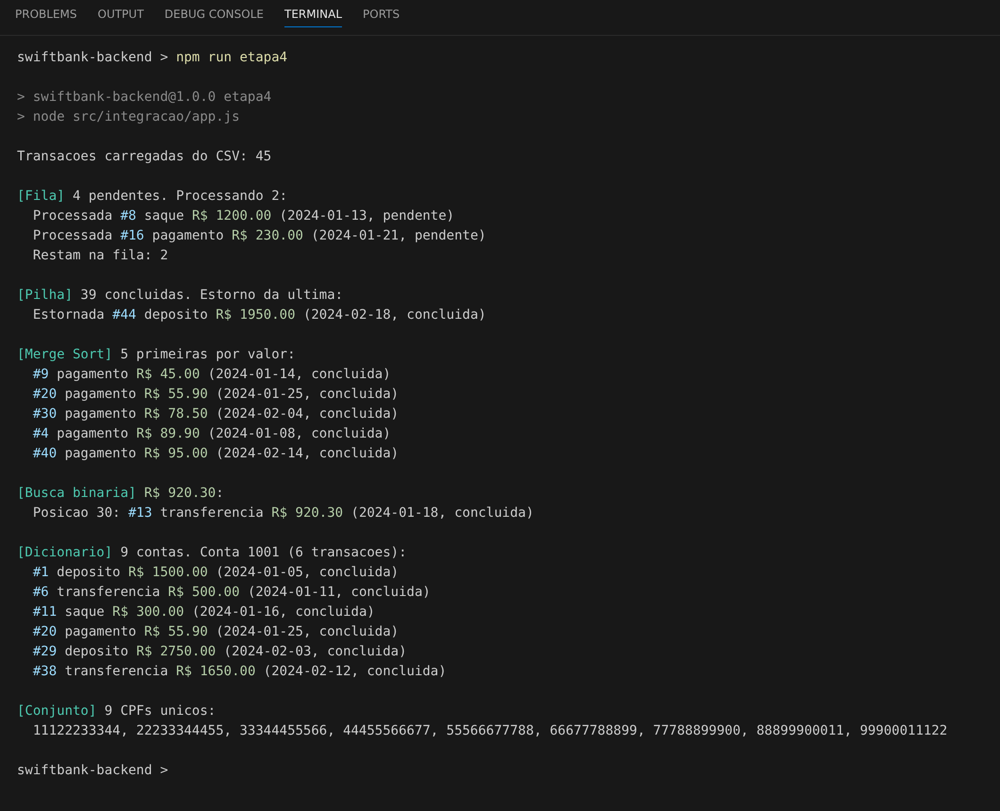
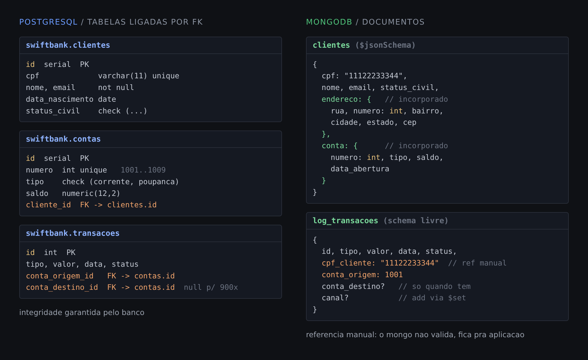

# SwiftBank Backend


Projeto que fiz pro checkpoint de Back-end Node.js nível 2 da Alura. A ideia é simular o back-end de um banco digital (o SwiftBank) e foi dividido em 4 etapas:

- etapa 1: fila e pilha pra processar e estornar transações
- etapa 2: algoritmos de ordenação (selection, insertion e merge sort) e busca binária
- etapa 3: banco relacional no PostgreSQL
- etapa 4: MongoDB + um script em Node juntando tudo

Não instalei nenhuma lib, usei só o que já vem no Node (`fs`, `readline` e `path`).



## Como rodar

Precisa ter instalado:

- Node 18 ou mais novo
- PostgreSQL 14+ (eu usei o pgAdmin junto)
- MongoDB 6+ com o mongosh (e o Compass se quiser ver os dados)

Primeiro copia o `.env.example` pra `.env` e coloca a senha do seu postgres:

```bash
cp .env.example .env
```

### Etapa 1 - fila e pilha

```bash
npm run etapa1
```

Joga as transações pendentes na fila e as concluídas na pilha. Depois processa 3 da fila e estorna as 2 últimas da pilha.

### Etapa 2 - ordenação e busca

```bash
npm run etapa2
```

Roda os 3 algoritmos (cada um numa cópia do array), mostra os 5 menores valores e faz a busca binária procurando uma transação de R$ 500,00.

### Etapa 3 - PostgreSQL

```bash
createdb -U postgres swiftbank
psql -U postgres -d swiftbank -f sql/01_ddl.sql
psql -U postgres -d swiftbank -f sql/02_dml.sql
psql -U postgres -d swiftbank -f sql/03_consultas.sql
psql -U postgres -d swiftbank -f sql/04_admin.sql
```

Roda da pasta raiz do projeto porque o `02_dml.sql` usa `\copy` com caminho relativo pro CSV. Se for usar o pgAdmin em vez do psql, comenta a linha do `\copy` e importa o CSV pelo Import/Export (deixei explicado no arquivo).

Backup:

```bash
pg_dump -U postgres -f /tmp/swiftbank_backup.sql swiftbank
```

### Etapa 4 - MongoDB

```bash
npm run mongo:setup
npm run mongo:consultas
```

O setup cria o banco, as coleções e insere os dados. O consultas roda os finds, o update e o deleteMany. Dá pra importar as transações pelo Compass também (Add Data > Import File), mas aí tem que tirar o insertMany do `setup.js`.

### Etapa 4 - integração

```bash
npm run etapa4
```

Usa a fila, a pilha, o merge sort, a busca binária (procurando 920.30), um dicionário agrupando as transações por conta e um conjunto com os CPFs sem repetir.

## Estrutura

```
data/              clientes.json e transacoes.csv
sql/               scripts do postgres (01 a 04)
src/
  utils/           leitura do csv
  estruturas/      fila, pilha, dicionario e conjunto
  algoritmos/      ordenacao e busca binaria
  mongo/           setup e consultas do mongo
  integracao/      app.js da etapa 4
```

## Algumas coisas que vale explicar

A leitura do CSV ficou num arquivo só (`src/utils/carregarTransacoes.js`) porque as etapas 1, 2 e 4 precisavam dela e não fazia sentido repetir o mesmo código 3 vezes.

No postgres deu um problema: o CSV vem com o número da conta (1001, 1002...) mas a tabela de transações aponta pro `id` da conta, não pro número. Resolvi jogando o CSV numa tabela temporária e depois fazendo um JOIN pelo número. Outra coisa é que os pagamentos têm conta de destino tipo 9001, 9002, que não existe na tabela de contas, então essas ficam NULL senão a FK quebra.

Depois de criar o índice em `valor` o EXPLAIN continuou mostrando Seq Scan. Pesquisei e é normal, a tabela é muito pequena (44 linhas) e pro postgres é mais rápido ler ela inteira do que usar o índice. Pra mostrar que o índice funciona eu desliguei o seq scan só naquela sessão (`SET enable_seqscan = off`) e aí ele usou o Index Scan.

No mongo o validador pede `int` no número do endereço e da conta, então tive que usar `NumberInt()` nos inserts senão dava erro de validação.

No merge sort usei `<=` na comparação pra manter a ordem original quando os valores são iguais (tem 3 transações de 500).

Fiz esse desenho pra comparar como ficou a modelagem nos dois bancos:



## Perguntas do checkpoint

**Por que fila pra pendentes e pilha pra estorno?**
Transação pendente tem que ser atendida na ordem que chegou, quem chegou primeiro sai primeiro, então é fila. Já o estorno faz sentido desfazer a última coisa que aconteceu primeiro, igual um ctrl+z, então é pilha.

**Por que o merge sort é melhor que selection e insertion?**
Selection e insertion são O(n²), cada item é comparado com quase todos os outros. Com 45 transações nem faz diferença, mas com 1 milhão vira coisa de 500 bilhões de comparações. O merge sort é O(n log n) porque vai dividindo pela metade, então pra 1 milhão fica na casa de 20 milhões. A busca binária também vai cortando pela metade (uns 20 passos pra 1 milhão), mas só funciona se a lista já estiver ordenada, por isso faço ela em cima do resultado do merge sort.

**Como o postgres garante integridade e performance?**
As constraints (PK, UNIQUE, CHECK e FK) não deixam entrar dado errado, tipo uma conta sem cliente. Com BEGIN/COMMIT/ROLLBACK dá pra testar um DELETE e voltar atrás se der ruim. Índice deixa as buscas mais rápidas em tabela grande, e VACUUM, ANALYZE e REINDEX fazem a manutenção pra não ir ficando lento com o tempo. E o pg_dump é o backup.

**Documento incorporado ou referência no mongo?**
Endereço e conta eu coloquei dentro do cliente porque sempre vão ser lidos junto com ele e não crescem, então uma busca já traz tudo. Já as transações ficaram numa coleção separada ligadas pelo CPF e pelo número da conta, porque elas só aumentam e se ficassem dentro do cliente o documento ia ficar gigante. O lado ruim é que o mongo não confere se o CPF existe mesmo, isso fica por conta da aplicação.

## Licença

MIT, tá no arquivo [LICENSE](LICENSE).
